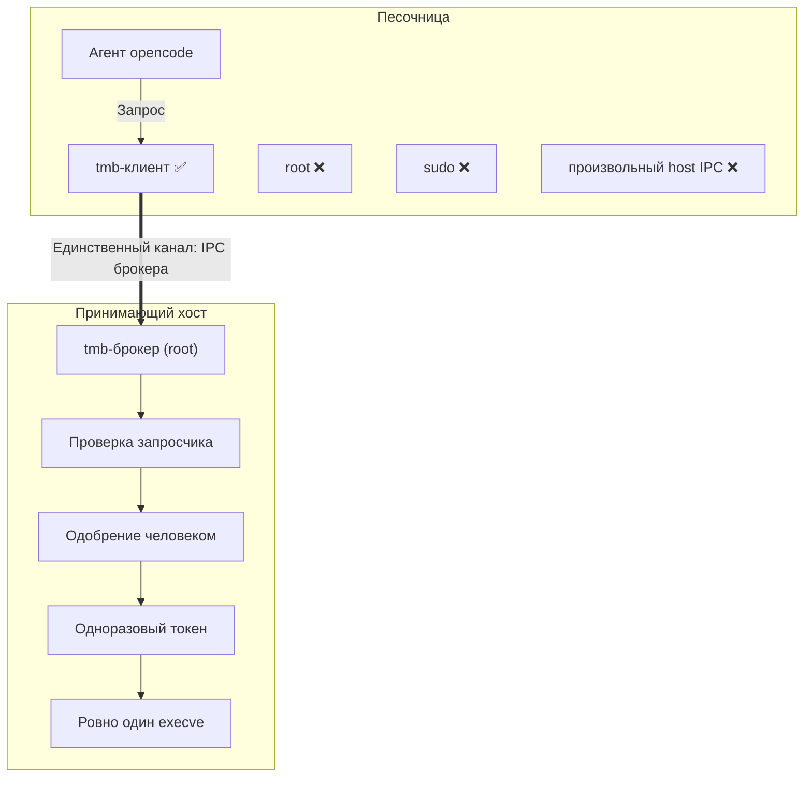
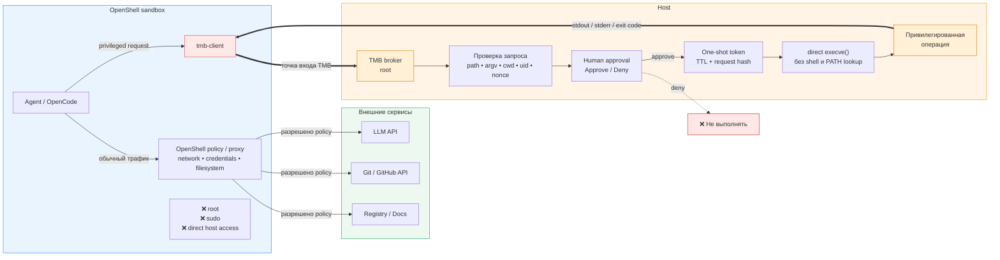
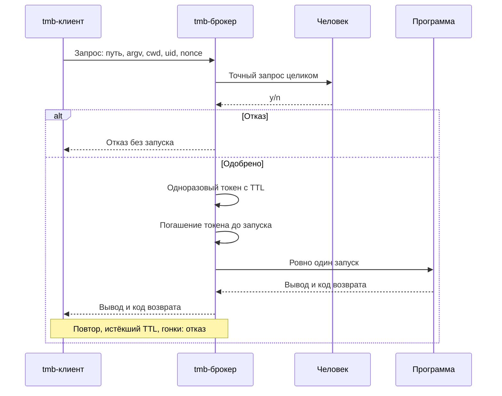

# TMB - Tool Mediation Broker

Неофициально: *trust me brother*.

TMB задуман как посредник между агентом opencode и привилегированным выполнением команд.
Пароль sudo агенту не передаётся: агент просит, человек одобряет, запрошенная команда выполняется ровно один раз.
TMB полностью ортогонален sudo: ни sudo, ни sudoers, ни PAM не меняются.

**Статус:** архитектура принята в [ADR 0002](docs/adr/0002-standalone-tmb-broker.md).
PoC подтверждён: 56/56 проверок PASS на ветке [`prototype/tmb-broker`](https://github.com/Vchekryzhov/tmb/tree/prototype/tmb-broker/prototype/tmb-broker).
Реализация MVP - [issue #4](https://github.com/Vchekryzhov/tmb/issues/4).
Инструментов установки для реальных машин пока нет. Ниже описана принятая архитектура, а не готовый продукт.

## Целевая схема

Агент живёт в песочнице, единственный канал наружу - точка входа брокера на принимающем хосте.



Слой песочницы - вопрос MVP. Целевой кандидат - NVIDIA OpenShell: исследование на ветке PoC ([RESEARCH-OPENSHELL.md](https://github.com/Vchekryzhov/tmb/blob/prototype/tmb-broker/prototype/tmb-broker/RESEARCH-OPENSHELL.md)) подтвердило совместимость, OpenCode - его задокументированный первый агент. Рекомендован вариант B: единственный TCP/MCP endpoint, разрешённый одним правилом `network_policies`; вариант A с bind-mount одного unix-сокета остаётся запасным. MVP-стенд PoC проще: непривилегированный контейнер без сети.

Детализация целевой схемы: обычный трафик агента уходит через OpenShell policy, привилегированный запрос - только через tmb-клиент к брокеру.



## Запрос и выполнение

- Запрос - структурированное сообщение брокеру: абсолютный путь программы, упорядоченный `argv`, cwd, целевой uid, nonce.
- Клиент ничего не исполняет: строит запрос, передаёт его брокеру, возвращает вывод и код возврата.
- Одобрение показывает точный запрос целиком: путь, `argv`, cwd, целевого пользователя. Диалог агента доказательством не считается.
- Одобренный запрос получает одноразовый токен с TTL. Погашение атомарно происходит до запуска и переживает рестарт брокера.
- Повторное предъявление токена, гонки и мутации запроса после одобрения отклоняются.
- Затем ровно один прямой запуск: без shell, без PATH-поиска, env только из allowlist брокера, `stdin` закрыт.
- env-политика и cwd - зона доопределения MVP.

## Почему не sudo-плагин

Точку встраивания в sudo проверяли два эксперимента, выжимка в [ADR 0002](docs/adr/0002-standalone-tmb-broker.md):

- Python approval-плагин работает, но требует пересборки sudo из исходников с `--enable-python`; ни один проверенный дистрибутив так sudo не собирает.
- Нативный плагин технически возможен, но любая строка `Plugin` в `/etc/sudo.conf` делает TMB зависимостью каждого вызова sudo. Битый или недоступный `.so` валит весь sudo на хосте, включая человеческий парольный путь.

Для распространяемого продукта это недопустимый failure domain. Эксперименты сохранены на ветке `prototype/sudo-integration`, история в [issue #1](https://github.com/Vchekryzhov/tmb/issues/1) (закрыт).

## Автотест PoC



## Отказоустойчивость (fail-closed)

При любой неисправности компонентов TMB агентный путь закрывается: команда не запускается.
Обычный парольный sudo, ssh и ОС хоста остаются нетронутыми.
Доказано проверкой N9 PoC: SIGKILL брокера - клиент завершается fail-closed с кодом 3, человеческий `sudo -S id` по-прежнему возвращает uid=0, в `/etc/sudo.conf` ноль строк `Plugin`.

## Изоляция и проверка

Все автоматические проверки - только в одноразовых непривилегированных контейнерах.
Запрещены `--privileged`, проброс `docker.sock` и монтирование чувствительных путей хоста.
Реестр проверок PoC (56/56): happy-путь, replay, TTL, мутация после одобрения, `sh -c`, env-контрабанда, не-абсолютный путь, чужой uid, рестарт брокера, N9.
Подробный вердикт и остаточные риски: [VERDICT-BROKER.md](https://github.com/Vchekryzhov/tmb/blob/prototype/tmb-broker/prototype/tmb-broker/VERDICT-BROKER.md) на ветке PoC.

## Вердикт OpenShell-майлстоуна

Связка «песочница OpenShell → mTLS-брокер» построена и доказана живыми прогонами
на macOS + Docker Desktop: реестр O0–O9 (политика как выключатель, изоляция
хоста, чужие сертификат/брокер/одобрение, fail-closed при смерти брокера,
живое одобрение с идентичностью просителя на консоли) — зелёный.
Итог и остаточные риски: [VERDICT-OPENSHELL.md](VERDICT-OPENSHELL.md);
решение — [ADR 0003](docs/adr/0003-sandbox-transport-tcp-mtls.md), спека —
[issue #5](https://github.com/Vchekryzhov/tmb/issues/5).

Воспроизведение одним прогоном (N-серия + docker-pair + OpenShell-риг,
суммарный вердикт в `harness/last-full-run.log`):

```bash
bash harness/run-all.sh
```

Точечные прогоны: `harness/run.sh` (N-серия, unix-сокет),
`harness/run-pair.sh` (docker-pair mTLS), `harness/run-openshell.sh`
(полный OpenShell-риг). Пререквизиты и наблюдаемые детали каждого — в
[harness/ref/README-PROTOTYPE.md](harness/ref/README-PROTOTYPE.md).

## Документы и задачи

- [CONTEXT.md](CONTEXT.md) - словарь домена.
- [ADR 0002](docs/adr/0002-standalone-tmb-broker.md) - принятое архитектурное решение.
- [ADR 0003](docs/adr/0003-sandbox-transport-tcp-mtls.md) - транспорт песочницы: TCP endpoint + mTLS-идентичность.
- [VERDICT-OPENSHELL.md](VERDICT-OPENSHELL.md) - вердикт OpenShell-майлстоуна (реестр O0-O9).
- [Итоги грила](docs/design/grill-results.md) - исторический первоисточник, суперседено ADR 0002.
- [#4: MVP брокера](https://github.com/Vchekryzhov/tmb/issues/4).
- [#2: подписант и Touch ID, будущий этап](https://github.com/Vchekryzhov/tmb/issues/2).
- [#3: remote-одобрение, будущий этап](https://github.com/Vchekryzhov/tmb/issues/3).
- Ветки экспериментов: `prototype/sudo-integration`, [`prototype/tmb-broker`](https://github.com/Vchekryzhov/tmb/tree/prototype/tmb-broker/prototype/tmb-broker).
