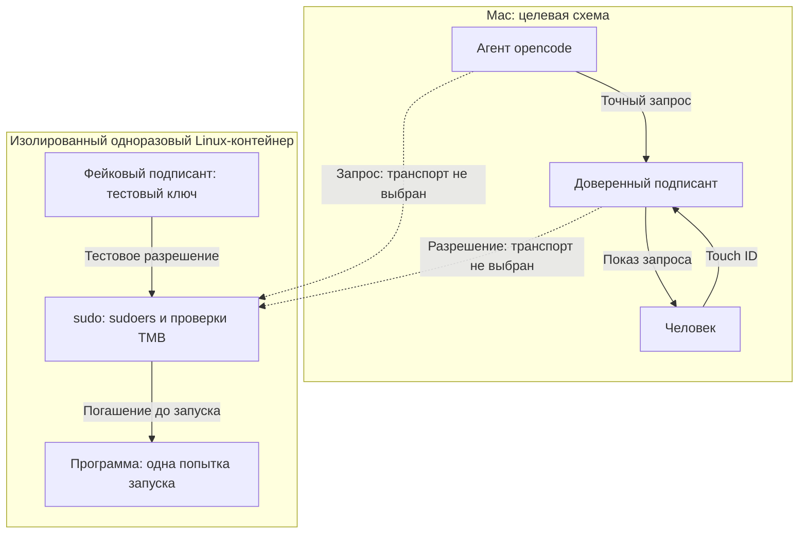
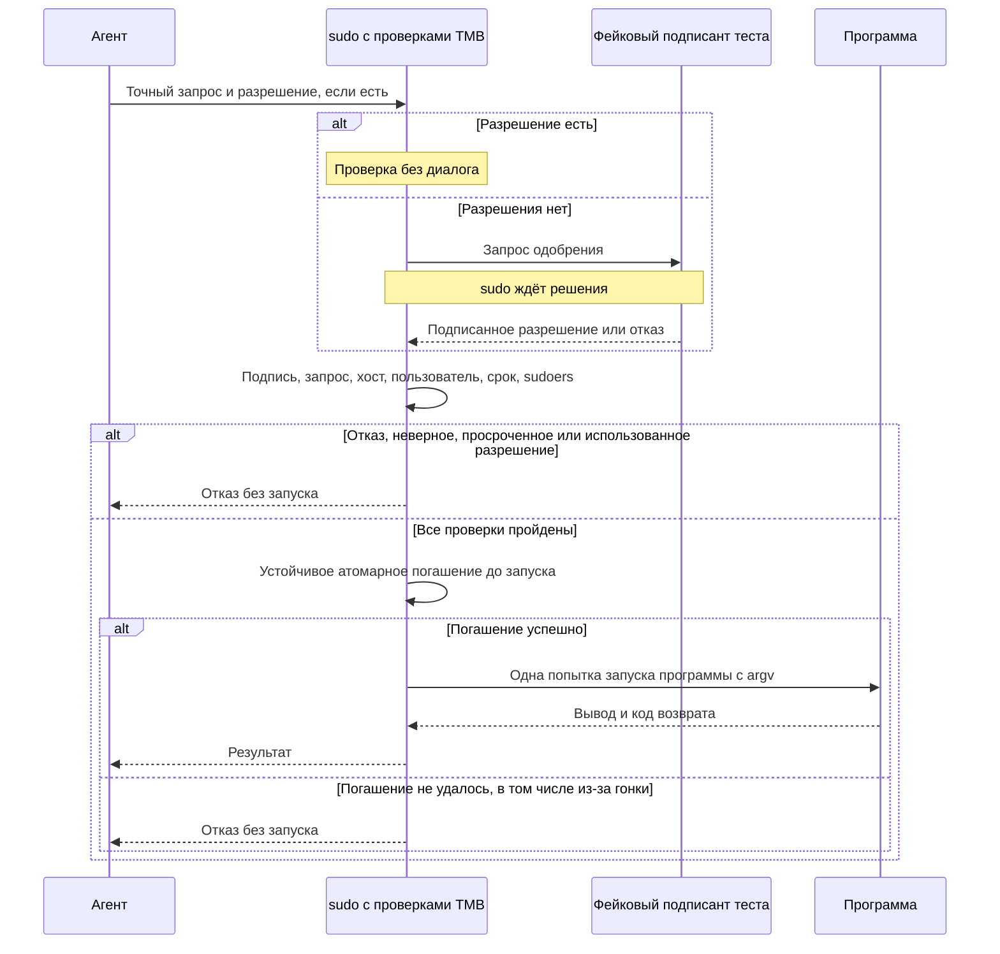

# TMB - Tool Mediation Broker

Неофициально: *trust me brother*.

TMB задуман как посредник между агентом opencode и привилегированным выполнением через sudo.
Пароль sudo не передаётся агенту или в чат. Обычный парольный sudo для человека и действующая политика sudoers должны сохраниться.

**Статус: проектирование, прототип ещё не реализован.** Инструментов запуска, установки и автотестов пока нет.
Живой удалённый сценарий с Mac и Touch ID не проверен. Ниже описаны цели, а не работающая система.

## Целевая схема

Доверенный подписант на Mac сам показывает фактические хост, пользователя выполнения, абсолютный путь программы и упорядоченный `argv`.
Затем он запрашивает Touch ID и подписывает разрешение на эту команду. Диалог агента не заменяет доверенный показ.
Пунктир на схеме обозначает будущие связи с ещё не выбранным транспортом, а не готовую удалённую интеграцию.

Цель прототипа - настоящее расширение sudo: проверки TMB участвуют в его пути, а команду запускает сам sudo один раз.
Отдельное исполнение в шлюзе с последующим повторным запуском через sudo не подходит.
Точку расширения sudo, реализацию подписанта, бэкенд ключа и транспорт должен определить прототип.
Хосты и пользователи задаются настройкой, без хардкода.

## Разрешение и запуск

- Подпись покрывает уникальный идентификатор запроса, хост, пользователя выполнения, абсолютный путь программы, упорядоченный `argv`, время выдачи и истечения.
- Принимающая сторона проверяет подпись, точное совпадение запроса, предназначенные хост и пользователя, срок действия.
- Срок действия - 60 секунд от выдачи на принятие и старт. Время работы уже запущенного процесса не ограничивается.
- Разрешение атомарно погашается **до запуска**, с устойчивым к перезапуску сохранением состояния. Максимум одна попытка запуска, включая гонки и повтор после перезапуска; успешное выполнение не гарантируется.
- Программа и `argv` запускаются напрямую, без неявного shell. Явно указанный интерпретатор допустим как обычная программа. `stdin` закрыт.
- `env` и `cwd` отложены: гарантий по ним прототип не даёт.
- Запросов состояния и восстановления нет. После неоднозначного сбоя новое одобрение может привести к повтору уже совершённого действия.

Концептуальный сценарий автотеста: фейковый подписант имитирует ожидание и решение человека, но использует настоящий криптографический тестовый ключ.
Проверка подписи не отключается. Реальный Touch ID относится к будущему подписанту на Mac, а не к этой автоматической проверке.

Неверное, просроченное или использованное разрешение отклоняется, а не заменяется новым одобрением в том же запросе.
Без разрешения путь TMB не запускает команду; обычный парольный sudo остаётся отдельным путём человека.

## Изоляция и проверка

Все автоматические и повторяемые тесты планируются **только в одноразовых Linux-контейнерах** с отдельными тестовыми ключами, доверием, конфигами и состоянием.
Запрещены `--privileged`, проброс `docker.sock` и монтирование чувствительных путей хоста.
Для прототипа нельзя менять PAM, sudoers или sshd реальных Mac, Linux-хостов и NAS.

Приёмка должна проверить:

- Точный показ запроса и единственную попытку запуска нужной программы с точным `argv` через реальный sudo.
- Тихую проверку готового разрешения; ожидание, одобрение и отказ фейкового подписанта при отсутствии разрешения.
- Отказ при неверной подписи, подмене запроса, хоста или пользователя, истечении 60 секунд и повторном использовании.
- Атомарность погашения при параллельных попытках и сохранение одноразовости после перезапуска.
- Сохранение политики sudoers и обычного парольного sudo для человека внутри контейнера.

Настоящий Touch ID - необязательная отдельная ручная проверка на Mac **без системных изменений**.
Linux-контейнеры не доказывают совместимость с DSM и не подтверждают живой удалённый сценарий.

## Документы и задачи

- [CONTEXT.md](CONTEXT.md) - словарь домена.
- [Итоги обсуждения](docs/design/grill-results.md) - принятые решения и открытые вопросы.
- [#1: прототип интеграции с sudo](https://github.com/Vchekryzhov/tmb/issues/1).
- [#2: доверенный подписант](https://github.com/Vchekryzhov/tmb/issues/2).
- [#3: будущий удалённый сценарий](https://github.com/Vchekryzhov/tmb/issues/3).
