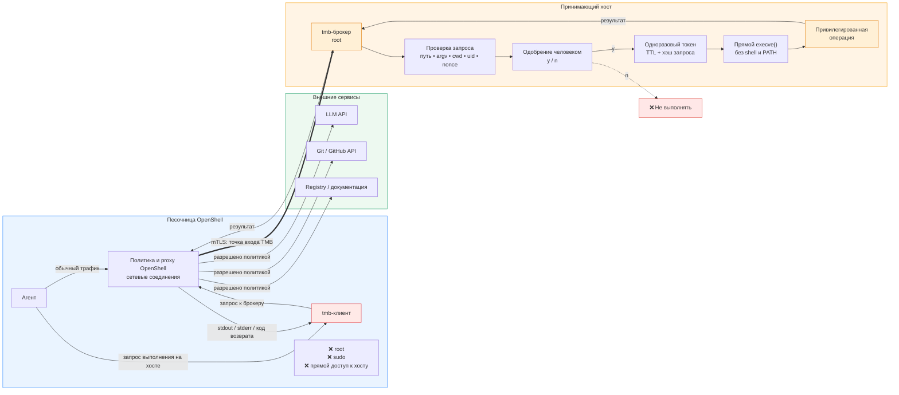
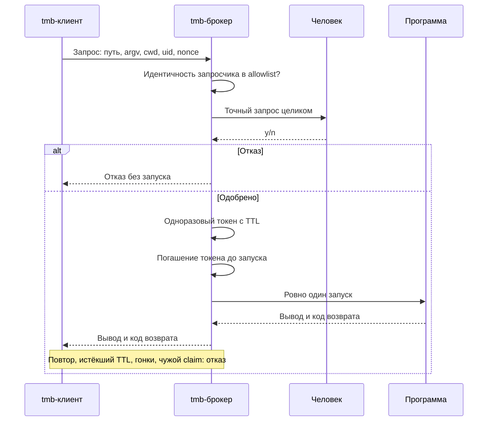

# TMB: Tool Mediation Broker

Неофициально: *trust me brother*.

[](https://github.com/Vchekryzhov/tmb/actions/workflows/ci.yml?query=branch%3Amain)
[](https://github.com/Vchekryzhov/tmb/actions/workflows/ci.yml?query=branch%3Amain+event%3Aschedule)
[](https://github.com/Vchekryzhov/tmb/actions/workflows/openshell-acceptance.yml?query=branch%3Amain)
[](docs/ci.md#пороги)
[](docs/ci.md#пороги)
[](docs/ci.md#пороги)
[](docs/ci.md#пороги)
[](docs/ci.md#пороги)
[](docs/ci.md#бейджи)
[](src/go.mod)
[](.go-version)

TMB посредничает между агентом в песочнице NVIDIA OpenShell и привилегированным выполнением команд на принимающем хосте.
Агент просит, человек одобряет точный запрос, брокер запускает одобренную команду не более одного раза.
Пароль sudo агенту не передаётся, а сам sudo, sudoers и PAM не меняются.

## Статус

Проект на стадии прототипа: архитектура принята, связка доказана на стенде, пакеты deb и rpm собираются релизом по тегу и проверены на VM с systemd; в эксплуатации на реальных машинах брокер ещё не был.

| Что | Где | Состояние |
| --- | --- | --- |
| Брокер как отдельный привилегированный демон, sudo не затрагивается | [ADR 0002](docs/adr/0002-standalone-tmb-broker.md) | принято |
| Песочница OpenShell, TCP endpoint с mTLS-идентичностью | [ADR 0003](docs/adr/0003-sandbox-transport-tcp-mtls.md) | принято |
| Одобряющий как отдельная роль, очередь одобрений вместо консоли | [ADR 0004](docs/adr/0004-approver-role-and-approval-queue.md) | принято, реализовано в майлстоуне A |
| Идентичность песочницы по открытому ключу, короткоживущие сертификаты | [ADR 0005](docs/adr/0005-requester-identity-by-public-key.md) | принято, реализация в майлстоуне B ([#39](https://github.com/Vchekryzhov/tmb/issues/39)) |
| OpenShell-майлстоун: реестр O0–O9 на живой связке | [#5](https://github.com/Vchekryzhov/tmb/issues/5), [вердикт](VERDICT-OPENSHELL.md) | доказан: N=77/77, pair=59/59, OpenShell=65/65 |
| Майлстоун A «политика и харденинг»: очередь одобрений, корни cwd, политика окружения, fd каталога, сборщик claim-файлов | [#27](https://github.com/Vchekryzhov/tmb/issues/27), [вердикт](VERDICT-A.md) | доказан: N=159/159, pair=67/67, OpenShell=65/65 |
| CI: переносимые проверки на каждый PR, единый статус `ci-gate` | [docs/ci.md](docs/ci.md) | фаза A действует, фазы B и C ждут |
| Майлстоун B «эксплуатация»: идентичность по ключу, reload, журнал, пакеты, пруф на VM | [#39](https://github.com/Vchekryzhov/tmb/issues/39), зонтик [#4](https://github.com/Vchekryzhov/tmb/issues/4) | в работе: CA в `tmb-broker`, reload по SIGHUP, журнал с fsync и схемой, пакеты deb/rpm и релиз по тегу готовы; VM-пруф на Lima с systemd: V=114/114 ([лог](harness/last-vm-run.log)) |

## Как это работает

Агент живёт в песочнице OpenShell без root, sudo и прямого доступа к хосту.
Обычный трафик агента (LLM API, Git, registry) регулируют сетевые правила OpenShell.
Запрос привилегированного выполнения идёт через `tmb`-клиент к брокеру на хосте; это соединение разрешает ровно одно правило `network_policies` с `protocol: tcp` и `tls: skip`.



Транспорт: length-prefixed JSON поверх TCP, не MCP.
На Linux-хосте брокер дополнительно слушает Unix-сокет с SO_PEERCRED для локального пути; исходный Unix-PoC проверяется отдельной N-серией.
OpenCode используется в базовом образе стенда, но протокол TMB не привязан к конкретному агенту.

### Запрос и выполнение

- Запрос: структурированное сообщение с абсолютным путём программы, упорядоченным `argv`, cwd, целевым uid и nonce.
- Клиент не выполняет команду: строит запрос, передаёт брокеру, возвращает вывод и код возврата.
- Брокер проверяет идентичность запросчика по allowlist до показа одобрения: uid из SO_PEERCRED на локальном пути, отпечаток открытого ключа песочницы на пути песочницы. Ключ рождается в песочнице (`tmb keygen`), хост подписывает только открытый ключ (`tmb-broker ca issue-sandbox`), перевыпуск сертификата allowlist не меняет.
- Одобрение показывает точный запрос целиком: путь, `argv`, cwd, целевой uid и кто просит. Диалог агента доказательством не считается.
- Одобренный запрос получает одноразовый токен с TTL. Токен привязан к идентичности запросчика и гасится атомарно до запуска; погашение переживает рестарт брокера.
- Повтор токена, гонки, чужой claim и мутация запроса после одобрения отклоняются.
- Запуск ровно один: прямой `execve` без shell и PATH-поиска, env только из allowlist брокера, `stdin` закрыт.
- Политика запроса отсекает лишнее до человека: cwd только внутри `allowed_cwd_roots` по realpath, ключи `fixed_env` не переопределяются, `PATH` только фиксированный, значения окружения в одну строку и не длиннее 4 KiB.
- Одобряет отдельная роль: запрос ждёт в очереди не дольше `approval_wait_seconds`, человек из `approver_uids` решает командой `tmb approve` через сокет хоста; по TLS одобрение невозможно.
- Конфиг перечитывается по SIGHUP (`systemctl reload`) без рестарта: allowlist, `approver_uids`, политика cwd и окружения, TTL и TLS-файлы меняются одним атомарным снимком, новые соединения получают новый сертификат брокера, открытые доживают со старым. Невалидный конфиг даёт `reload_failed` и оставляет действующий; сокеты, `tls_addr`, `state_dir`, `log_path`, `pid_file` и `approval_default` применяются только при старте (`reload_ignored_field`). Очередь и pending-одобрения переживают reload, элемент очереди хранит идентичность и не перепроверяется: запрос, который уже ждёт, выполнится после одобрения, даже если песочницу за это время удалили из allowlist; новое соединение, в том числе отдельный claim, проверяется по allowlist заново.
- Журнал (JSONL, `log_path`) пишется с `fsync` на каждое событие до ответа клиенту, каждое событие несёт `schema: 1`, события и поля описаны в [docs/audit-schema.md](docs/audit-schema.md). Ошибка записи, `fsync` или reopen закрывает приём: новые соединения получают `audit_unavailable`, ничего не запускается, уже запущенная команда дорабатывает, а её `exec_exit` уходит в stderr брокера. SIGHUP открывает файл журнала заново по пути (ротация logrotate) и этим же выводит из состояния «журнал недоступен».



### Fail-closed

При любой неисправности компонентов TMB агентный путь закрывается: команда не запускается, клиент завершается с кодом 3.
Обычный парольный sudo, ssh и ОС хоста остаются нетронутыми.
Доказано сценариями N9 и O5: после SIGKILL брокера человеческий `sudo -S id` по-прежнему возвращает uid=0, в `/etc/sudo.conf` ноль строк `Plugin`.

## Почему не sudo-плагин

Точку встраивания в sudo проверяли два эксперимента, выжимка в [ADR 0002](docs/adr/0002-standalone-tmb-broker.md):

- Python approval-плагин работает, но требует пересборки sudo из исходников с `--enable-python`; ни один проверенный дистрибутив так sudo не собирает.
- Нативный плагин технически возможен, но любая строка `Plugin` в `/etc/sudo.conf` делает TMB зависимостью каждого вызова sudo. Битый или недоступный `.so` валит весь sudo на хосте, включая человеческий парольный путь.

Для распространяемого продукта это недопустимый failure domain.
Эксперименты сохранены на ветке `prototype/sudo-integration`, история в [#1](https://github.com/Vchekryzhov/tmb/issues/1) (закрыт).

Сравнение с FreeIPA, JIT-доступом и approval-плагином sudo: [docs/alternatives.md](docs/alternatives.md).

## Запуск и проверка

Сценарные проверки идут только в одноразовых непривилегированных контейнерах; Go-тесты запускаются отдельно, без привилегий хоста.
Запрещены `--privileged`, проброс `docker.sock` и монтирование чувствительных путей хоста.

Полный прогон (N-серия, docker-pair и OpenShell-риг), суммарный вердикт в `harness/last-full-run.log`:

```bash
bash harness/run-all.sh
```

Точечные прогоны: `harness/run.sh` (N-серия, Unix-сокет), `harness/run-pair.sh` (docker-pair, mTLS), `harness/run-openshell.sh` (полный OpenShell-риг). `harness/run-vm.sh` (или `ci/run.sh vm`) ставит пакеты текущего коммита в одноразовую Lima-VM с systemd и прогоняет V-серию V0–V9, лог в `harness/last-vm-run.log`; `bash harness/run-all.sh --vm` добавляет её четвёртой частью. Подробности в [docs/ci.md](docs/ci.md#vm-пруф).
Пререквизиты и топология стенда описаны в [harness/ref/README-PROTOTYPE.md](harness/ref/README-PROTOTYPE.md).

Проверки CI локально (lint, тесты, покрытие, безопасность, сборка, короткий fuzz):

```bash
ci/run.sh tools && ci/run.sh local
```

Состав проверок, пороги и исключения описаны в [docs/ci.md](docs/ci.md).

Пакеты deb и rpm (`tmb-broker`, `tmb`) и архивы клиента из чистого checkout собираются в `out/dist` одной командой; нужны Go, git и curl, nfpm ставится сам по пину:

```bash
ci/run.sh dist
```

Версия берётся из `TMB_VERSION` или тега `v*` на HEAD, иначе `v0.0.0-dev+<sha>`. После установки `tmb-broker` остаётся скопировать `/etc/tmb/config.json.example` в `/etc/tmb/config.json`, вписать запросчиков и одобряющих и запустить `systemctl start tmb-broker`. Состав пакетов, проверка установки и релиз по тегу: [docs/ci.md](docs/ci.md#пакеты-и-релиз).

## Документы

- [CONTEXT.md](CONTEXT.md): глоссарий домена.
- [ADR 0001](docs/adr/0001-oneshot-ssh-certificates.md): SSH-сертификаты с force-command, отклонён, причины внутри.
- [ADR 0002](docs/adr/0002-standalone-tmb-broker.md): брокер как отдельный демон, sudo не затрагивается.
- [ADR 0003](docs/adr/0003-sandbox-transport-tcp-mtls.md): песочница OpenShell, TCP endpoint с mTLS-идентичностью.
- [ADR 0004](docs/adr/0004-approver-role-and-approval-queue.md): одобряющий как отдельная роль, очередь одобрений.
- [ADR 0005](docs/adr/0005-requester-identity-by-public-key.md): идентичность песочницы по открытому ключу.
- [VERDICT-OPENSHELL.md](VERDICT-OPENSHELL.md): вердикт OpenShell-майлстоуна, реестр O0–O9, отклонения от спеки, остаточные риски.
- [VERDICT-A.md](VERDICT-A.md): вердикт майлстоуна A, реестр N13–N22 и PAIR-APPROVE, отклонения от спеки, остаточные риски.
- [docs/alternatives.md](docs/alternatives.md): чем TMB отличается от FreeIPA, JIT-доступа и approval-плагина sudo.
- [docs/ci.md](docs/ci.md): CI, фазы, `ci-gate`, пороги, исключения.
- [harness/ref/README-PROTOTYPE.md](harness/ref/README-PROTOTYPE.md): стенды, топология, пререквизиты.
- [harness/ref/VERDICT-BROKER.md](harness/ref/VERDICT-BROKER.md): исторический вердикт исходного Unix-PoC.
- [Итоги грила](docs/design/grill-results.md): исторический первоисточник, суперседён ADR 0002.
- [Итоги грила по этапу после #5](docs/design/grill-results-stage2.md): решения для майлстоунов A и B, основа ADR 0004 и 0005.

## Задачи

- [#4](https://github.com/Vchekryzhov/tmb/issues/4): зонтик этапа после #5: майлстоун A [#27](https://github.com/Vchekryzhov/tmb/issues/27) доказан ([вердикт](VERDICT-A.md)), майлстоун B [#39](https://github.com/Vchekryzhov/tmb/issues/39) в работе: идентичность по ключу, CA, reload, журнал, пакеты, пруф на VM.
- [#13](https://github.com/Vchekryzhov/tmb/issues/13), [#14](https://github.com/Vchekryzhov/tmb/issues/14), [#15](https://github.com/Vchekryzhov/tmb/issues/15): спека CI, внедрение и известные GAP.
- [#2](https://github.com/Vchekryzhov/tmb/issues/2): доверенный подписант с Touch ID, будущий этап.
- [#3](https://github.com/Vchekryzhov/tmb/issues/3): remote-одобрение, будущий этап.
- Ветки экспериментов: `prototype/sudo-integration`, [`prototype/tmb-broker`](https://github.com/Vchekryzhov/tmb/tree/prototype/tmb-broker/prototype/tmb-broker).
