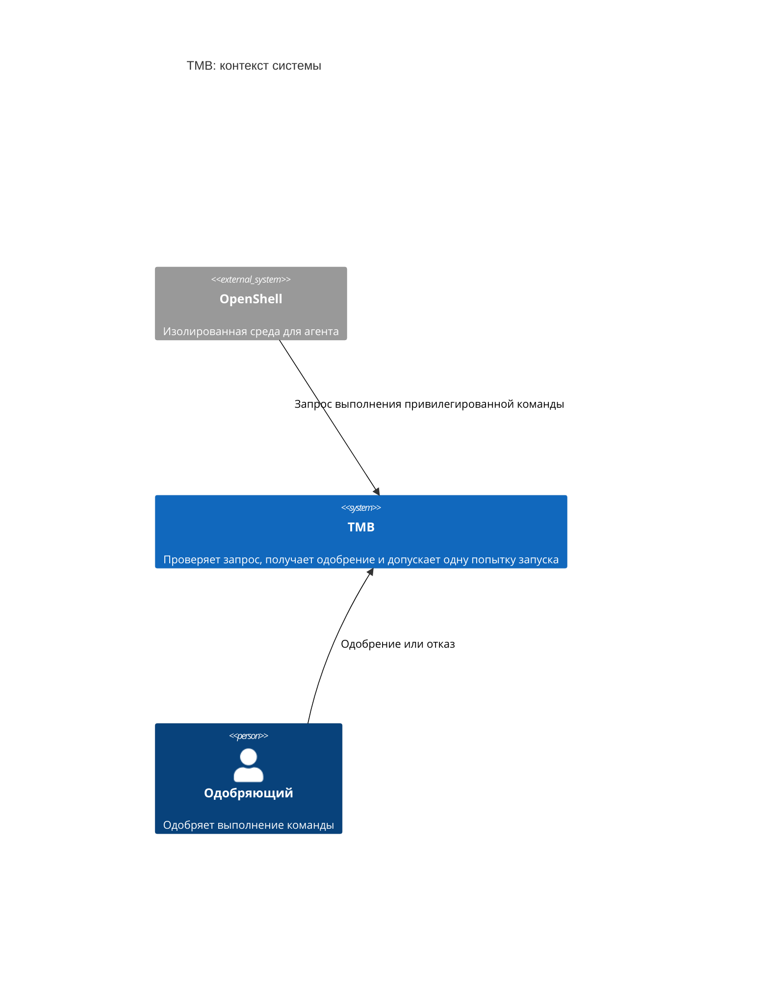
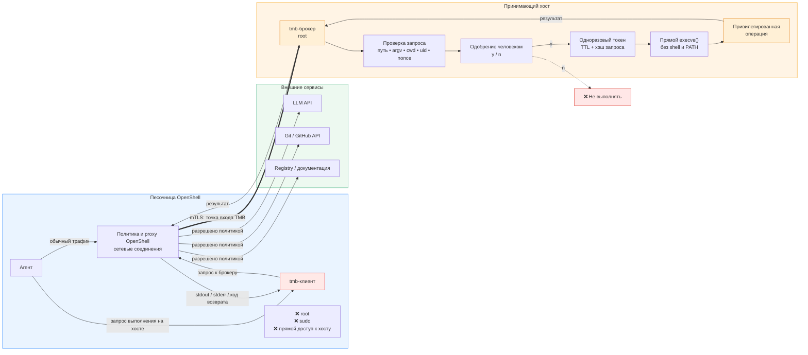
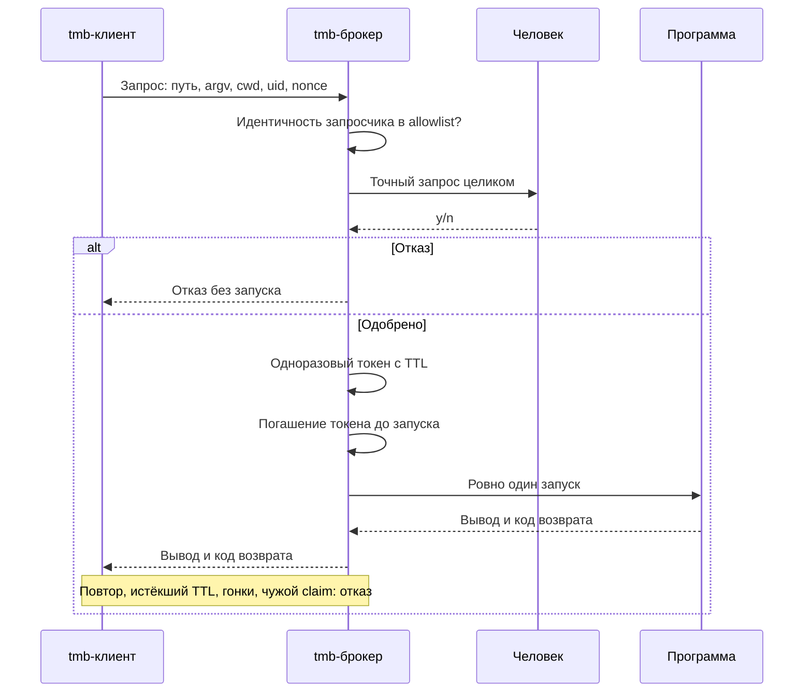
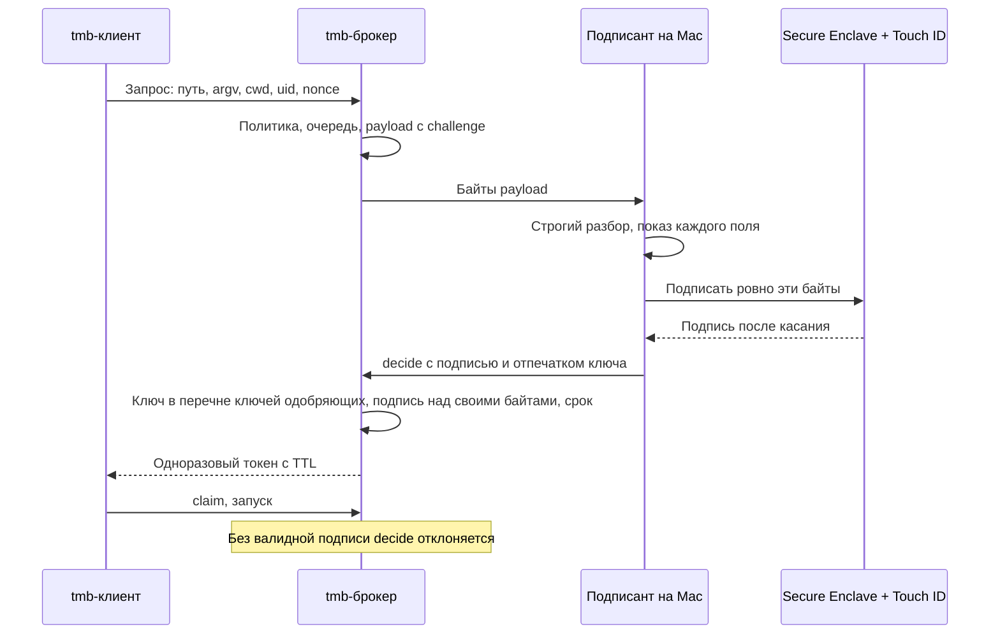

# TMB: Tool Mediation Broker

Неофициально: *trust me brother*.

[](https://github.com/Vchekryzhov/tmb/actions/workflows/ci.yml?query=branch%3Amain)
[](https://github.com/Vchekryzhov/tmb/actions/workflows/ci.yml?query=branch%3Amain+event%3Aschedule)
[](https://github.com/Vchekryzhov/tmb/actions/workflows/openshell-acceptance.yml?query=branch%3Amain)
[](docs/ci.md#пороги)
[](docs/ci.md#пороги)
[](docs/ci.md#пороги)
[](docs/ci.md#пороги)
[](docs/ci.md#пороги)
[](docs/ci.md#бейджи)
[](src/go.mod)
[](.go-version)

TMB посредничает между агентом в песочнице NVIDIA OpenShell и привилегированным выполнением команд на принимающем хосте.
Агент просит, человек одобряет точный запрос, брокер запускает одобренную команду не более одного раза.
Пароль sudo агенту не передаётся, а сам sudo, sudoers и PAM не меняются.



## Статус

Проект на стадии прототипа: архитектура принята, связка доказана на стенде, пакеты deb и rpm собираются релизом по тегу и проверены на VM с systemd; в эксплуатации на реальных машинах брокер ещё не был.

| Что | Где | Состояние |
| --- | --- | --- |
| Брокер как отдельный привилегированный демон, sudo не затрагивается | [ADR 0002](docs/adr/0002-standalone-tmb-broker.md) | принято |
| Песочница OpenShell, TCP endpoint с mTLS-идентичностью | [ADR 0003](docs/adr/0003-sandbox-transport-tcp-mtls.md) | принято |
| Одобряющий как отдельная роль, очередь одобрений вместо консоли | [ADR 0004](docs/adr/0004-approver-role-and-approval-queue.md) | принято, реализовано в майлстоуне A |
| Идентичность песочницы по открытому ключу, короткоживущие сертификаты | [ADR 0005](docs/adr/0005-requester-identity-by-public-key.md) | принято, реализация в майлстоуне B ([#39](https://github.com/Vchekryzhov/tmb/issues/39)) |
| Доверенный подписант с Touch ID: подписанное решение проверяет брокер | [ADR 0006](docs/adr/0006-trusted-signer-touch-id.md) | принято, реализовано на этапе подписанта ([#99](https://github.com/Vchekryzhov/tmb/issues/99)) |
| Подписант: классы ключей, порог подписей, короткий код, ключ идентичности брокера | [ADR 0007](docs/adr/0007-signer-key-classes-threshold-host-identity.md) | принято, реализовано в [#99](https://github.com/Vchekryzhov/tmb/issues/99); решения диспетчера Р3, Р6, Р7, Р8 ждут подтверждения владельца |
| Этап подписанта: подписанное решение в брокере, порог подписей, `tmb approve` в машинном режиме, приложение в строке меню macOS | [#99](https://github.com/Vchekryzhov/tmb/issues/99), часть [#2](https://github.com/Vchekryzhov/tmb/issues/2) | реализован: N=272/272 ([лог](harness/last-run.log)), pair=112/112 ([лог](harness/last-pair-run.log)); полный прогон с OpenShell-ригом после N31–N37 не повторялся; ручная проверка Touch ID ([MANUAL-CHECK](signer/MANUAL-CHECK.md)) ждёт владельца |
| OpenShell-майлстоун: реестр O0–O9 на живой связке | [#5](https://github.com/Vchekryzhov/tmb/issues/5), [вердикт](VERDICT-OPENSHELL.md) | доказан: N=77/77, pair=59/59, OpenShell=65/65 |
| Майлстоун A «политика и харденинг»: очередь одобрений, корни cwd, политика окружения, fd каталога, сборщик claim-файлов | [#27](https://github.com/Vchekryzhov/tmb/issues/27), [вердикт](VERDICT-A.md) | доказан: N=159/159, pair=67/67, OpenShell=65/65 |
| CI: переносимые проверки на каждый PR, единый статус `ci-gate` | [docs/ci.md](docs/ci.md) | фаза A действует, фазы B и C ждут |
| Майлстоун B «эксплуатация»: идентичность по ключу, reload, журнал, пакеты, пруф на VM | [#39](https://github.com/Vchekryzhov/tmb/issues/39), зонтик [#4](https://github.com/Vchekryzhov/tmb/issues/4) | в работе: CA в `tmb-broker`, reload по SIGHUP, журнал с fsync и схемой, пакеты deb/rpm и релиз по тегу готовы; VM-пруф на Lima с systemd: V=114/114 ([лог](harness/last-vm-run.log)) |

## Как это работает

Агент живёт в песочнице OpenShell без root, sudo и прямого доступа к хосту.
Обычный трафик агента (LLM API, Git, registry) регулируют сетевые правила OpenShell.
Запрос привилегированного выполнения идёт через `tmb`-клиент к брокеру на хосте; это соединение разрешает ровно одно правило `network_policies` с `protocol: tcp` и `tls: skip`.



Транспорт: length-prefixed JSON поверх TCP, не MCP.
На Linux-хосте брокер дополнительно слушает Unix-сокет с SO_PEERCRED для локального пути; исходный Unix-PoC проверяется отдельной N-серией.
OpenCode используется в базовом образе стенда, но протокол TMB не привязан к конкретному агенту.

### Запрос и выполнение

- Запрос: структурированное сообщение с абсолютным путём программы, упорядоченным `argv`, cwd, целевым uid и nonce.
- Клиент не выполняет команду: строит запрос, передаёт брокеру, возвращает вывод и код возврата.
- Брокер проверяет идентичность запросчика по allowlist до показа одобрения: uid из SO_PEERCRED на локальном пути, отпечаток открытого ключа песочницы на пути песочницы. Ключ рождается в песочнице (`tmb keygen`), хост подписывает только открытый ключ (`tmb-broker ca issue-sandbox`), перевыпуск сертификата allowlist не меняет.
- Одобрение показывает точный запрос целиком: путь, `argv`, cwd, целевой uid и кто просит. Диалог агента доказательством не считается.
- Одобренный запрос получает одноразовый токен с TTL. Токен привязан к идентичности запросчика и гасится атомарно до запуска; погашение переживает рестарт брокера.
- Повтор токена, гонки, чужой claim и мутация запроса после одобрения отклоняются.
- Запуск ровно один: прямой `execve` без shell и PATH-поиска, env только из allowlist брокера, `stdin` закрыт.
- Скрипты с `#!` не запускаются: брокер исполняет закреплённый дескриптор файла (`/proc/self/fd/N`), а интерпретатор получает этот путь уже закрытым. Первые байты брокер читает через тот же закреплённый дескриптор, а не по пути, поэтому подмена пути между проверкой и закреплением ничего не даёт. Такой запрос отклоняется до показа одобрения с причиной `executable_script` и повторно при claim до погашения токена, если одобренный файл переписали на месте; файл, который не читается, отклоняется с `executable_unreadable`. Скрипт запускается явным вызовом интерпретатора: `tmb exec --root -- /usr/bin/python3 /path/script.py`.
- Политика запроса отсекает лишнее до человека: cwd только внутри `allowed_cwd_roots` по realpath, ключи `fixed_env` не переопределяются, `PATH` только фиксированный, значения окружения в одну строку и не длиннее 4 KiB.
- Одобряет отдельная роль: запрос ждёт в очереди не дольше `approval_wait_seconds`, человек из `approver_uids` решает командой `tmb approve` через сокет хоста; по TLS одобрение невозможно.
- Решение может быть подписано ([ADR 0006](docs/adr/0006-trusted-signer-touch-id.md), [ADR 0007](docs/adr/0007-signer-key-classes-threshold-host-identity.md)): брокер строит для элемента очереди payload одобрения с `host_id`, отпечатком своего ключа идентичности (создаётся в `state_dir` при первом старте, печатается при старте и командой `tmb-broker identity`), challenge и сроками, а `decide` с подписью принимает, только если ключ есть в `approver_keys` и подпись сходится с этими байтами до крайнего срока. С `require_signed_decision` неподписанное одобрение отклоняется (`signature_required`), неподписанный отказ принимается. Токен живёт не дольше подписанного TTL. `required_signatures` (по умолчанию 1) задаёт порог подписей разными ключами: до порога брокер отвечает `recorded` с числом подписей и пишет `signature_recorded`, повторная подпись тем же ключом отклоняется (`signature_duplicate`), первый `deny` снимает элемент. Записи `approver_keys` с классом `mac-se` (`ios-se` и `u2f` зарезервированы), порог и требование подписи применяются по SIGHUP; порог больше 1 без `require_signed_decision` или больше числа ключей это ошибка конфига. Анроллмент ключа, сверка ключа идентичности и порядок включения описаны ниже, в разделе «Доверенный подписант с Touch ID».
- Конфиг перечитывается по SIGHUP (`systemctl reload`) без рестарта: allowlist, `approver_uids`, политика cwd и окружения, TTL и TLS-файлы меняются одним атомарным снимком, новые соединения получают новый сертификат брокера, открытые доживают со старым. Невалидный конфиг даёт `reload_failed` и оставляет действующий; сокеты, `tls_addr`, `state_dir`, `log_path`, `pid_file` и `approval_default` применяются только при старте (`reload_ignored_field`). Очередь и pending-одобрения переживают reload, элемент очереди хранит идентичность и не перепроверяется: запрос, который уже ждёт, выполнится после одобрения, даже если песочницу за это время удалили из allowlist; новое соединение, в том числе отдельный claim, проверяется по allowlist заново.
- Журнал (JSONL, `log_path`) пишется с `fsync` на каждое событие до ответа клиенту, каждое событие несёт версию схемы `schema` (сейчас `3`), события и поля описаны в [docs/audit-schema.md](docs/audit-schema.md). Ошибка записи, `fsync` или reopen закрывает приём: новые соединения получают `audit_unavailable`, ничего не запускается, уже запущенная команда дорабатывает, а её `exec_exit` уходит в stderr брокера. SIGHUP открывает файл журнала заново по пути (ротация logrotate) и этим же выводит из состояния «журнал недоступен».



### Доверенный подписант с Touch ID

Решения в [ADR 0006](docs/adr/0006-trusted-signer-touch-id.md) и [ADR 0007](docs/adr/0007-signer-key-classes-threshold-host-identity.md), дизайн и модель угроз в [docs/design/trusted-signer.md](docs/design/trusted-signer.md), этап реализации [#99](https://github.com/Vchekryzhov/tmb/issues/99). Подписант это приложение в строке меню macOS (папка `signer/`, Swift): оно по SSH забирает очередь одобрений с хоста, показывает каждый элемент целиком и после касания Touch ID подписывает ключом Secure Enclave ровно те байты, которые построил брокер. Брокер проверяет подпись над своими байтами и только потом выдаёт токен. Ключ не покидает Secure Enclave, без касания подписи нет, а отмена, таймаут и ошибка биометрии дают явный неподписанный `deny`.

Это подписанное решение по элементу очереди, а не автономное подписанное разрешение без очереди: тот вариант (Г) остаётся за [#3](https://github.com/Vchekryzhov/tmb/issues/3). Остаточный риск: root на Mac управляет показом и числом подписей за касание, поэтому может подменить байты между показом и подписью. Порог подписей от этого не защищает, пока действующий класс ключей один (`mac-se`): ключи одного Mac root использует все, а порог закрывает только потерю ключа и случайное касание (ADR 0007, остаточные риски). Защиту от компрометации Mac даст второе устройство (iPhone, класс `ios-se`).



#### Сборка и ручная проверка

Приложение собирается без Xcode-проекта: `signer/Scripts/build-app.sh [OUTDIR]` (по умолчанию `signer/.build/app/TMBSigner.app`) делает `swift build -c release` и подписывает бандл ad hoc с hardened runtime и `signer/App/TMBSigner.entitlements`; своя identity задаётся через `TMB_SIGNER_IDENTITY`. `signer/Scripts/check-entitlements.sh signer/.build/app/TMBSigner.app` проверяет подпись и отсутствие debug-entitlements. Тесты ядра и транспорта: `signer/Scripts/test.sh` или `ci/run.sh signer` (обязательная проверка PR, см. [docs/ci.md](docs/ci.md)). Приложение отказывается работать вне локальной GUI-сессии (код 3) и с нарушенной подписью кода (код 4). Touch ID, Secure Enclave и GUI-сессии на раннерах нет, поэтому живое поведение проверяет владелец по протоколу [signer/MANUAL-CHECK.md](signer/MANUAL-CHECK.md) и записывает результаты в его таблицу.

#### Анроллмент ключа одобряющего

1. В приложении меню Create Key...: ключ создаётся в Secure Enclave и хранится блобом в `~/Library/Application Support/TMB Signer/keys/`. Приложение копирует в буфер обмена запись для `approver_keys` вида `{"name":"mac-work","class":"mac-se","public_key":"<base64 DER SPKI>"}` и показывает отпечаток ключа. Ту же запись печатает `TMBSigner.app/Contents/MacOS/TMBSigner --print-key [NAME]` из Terminal.app.
2. На хосте добавить запись в `approver_keys` в `/etc/tmb/config.json` и задать `host_id` (пустой означает имя хоста ОС). Действующий класс один, `mac-se`; `ios-se` и `u2f` зарезервированы, и конфиг с ними не применяется.
3. Перечитать конфиг: `sudo systemctl reload tmb-broker` (SIGHUP). В журнале появляется `reload`; негодный конфиг даёт `reload_failed`, и действует прежний.
4. Пользователь одобряющего на хосте входит с Mac по SSH ключом без пароля, его uid есть в `approver_uids`. В `config.json` подписанта описывается хост (`ssh`, `host_id`, при необходимости `port`, `tmb`, `socket`), формат в шаге 6 подготовки MANUAL-CHECK.

Отзыв ключа это удаление записи из `approver_keys` и SIGHUP. Новый набор отпечатков Touch ID делает ключ непригодным: нужен новый ключ и новый анроллмент.

#### Ключ идентичности брокера

При первом старте брокер создаёт ключ P-256 `state_dir/identity.key` с правами только владельца; файл с чужими правами или владельцем это ошибка старта. Отпечаток ключа идёт в payload полем `host_key`, печатается при старте строкой `tmb-broker: identity host_id=... host_key=...` и командой `sudo tmb-broker identity` (две строки, `host_id` и `host_key`). Перечитывание конфига ключ не меняет, TLS-сертификат брокера с ним не связан. Подписант запоминает пару `host_id` и `host_key` при первом элементе с хоста (привязка хоста, TOFU, как `known_hosts`) и пишет об этом в окне: сверьте `host_key` в окне с выводом `tmb-broker identity`. Если у известного хоста отпечаток сменился, подписант предупреждает и отправляет `deny`; привязка меняется только явным Forget в меню Pinned Hosts.

#### Порог подписей и включение `require_signed_decision`

- `required_signatures` (по умолчанию 1) задаёт, сколько подписей разными ключами из `approver_keys` нужно для одобрения. До порога ответ одобряющему `recorded` с числом подписей, в журнале `signature_recorded`; повтор тем же ключом отклоняется (`signature_duplicate`); первый `deny` снимает элемент. Порог считает ключи, а не людей: два ключа `mac-se` одного человека набирают порог 2. Перечитывание с меньшим порогом ждущие элементы само не одобряет: элемент, у которого уже набрано подписей не меньше нового порога, одобряет следующая подпись другим ключом, иначе он истекает по `approval_wait_seconds`. Список очереди в это время показывает, например, `1 of 1` (ADR 0007, Р13).
- Пока `require_signed_decision` выключен, брокер принимает и подписанные, и неподписанные решения. Это период перехода: в журнале у события `approval` поле `signed` и массив `approver_keys` показывают, какие решения уже приходят с подписью (схема журнала `3`, [docs/audit-schema.md](docs/audit-schema.md)).
- Когда все одобряющие подписывают, включить `"require_signed_decision": true` и сделать SIGHUP. После этого неподписанное одобрение, в том числе `tmb approve --yes` на хосте, отклоняется кодом `signature_required`, а неподписанный `deny` по-прежнему принимается (ADR 0007, Р10). Аварийного неподписанного пути одобрения нет намеренно (ADR 0006, В9). `require_signed_decision` действует только в режиме `queue`: с `approval_default` или `-approval` `manual` либо `mock-approve` брокер не стартует, а перечитывание такого конфига даёт `reload_failed` (ADR 0007, Р11).
- Процесс получает ровно то окружение, которое было в payload и которое видел одобряющий: перечитывание `fixed_env` или `allowed_env_keys` после постановки в очередь его не меняет (ADR 0007, Р12). Значения `fixed_env` поэтому входят в payload и в журнал (поле `payload` события `approval`, base64): секреты в `fixed_env` не кладут. Открытых ключей одобряющих журнал не хранит, только отпечатки: чтобы перепроверить старые подписи после смены ключей, храните историю конфига.
- Ошибки конфига: порог больше 1 без `require_signed_decision`, `require_signed_decision` при пороге больше числа ключей.

#### Машинный режим `tmb approve`

Подписант ходит на хост по SSH и вызывает `tmb approve` в машинном режиме; тот же режим годится для своего подписанта или стенда.

- `tmb approve --list --json [--socket PATH]` печатает одну строку `{"type":"queue","items":[...]}`. Элементы передаются как их прислал брокер: `payload` (base64 точных байтов для подписи), `short_code`, `host_id`, `host_key`, `challenge`, `deadline`, `token_ttl_seconds`, а при подписанном режиме `signatures_required` и `signatures`.
- `tmb approve --decide [--socket PATH]` читает со stdin один JSON-объект `{"item_id","item_hash","decision"}` и вместе либо без них `signature` (base64 DER ECDSA P-256 над SHA-256 всего payload) и `approver_key` (отпечаток SPKI). Ответ брокера печатается одной строкой (`decided`, `recorded` или `denied` с причиной). Коды выхода: 0 принято, 1 элемента нет или уже решён, 2 ошибка использования или негодный stdin, 3 транспорт, 125 прочий отказ брокера (`signature_invalid`, `signature_required`, `approver_key_unknown`, `decision_expired` и другие).
- В человеческом выводе `tmb approve --list` у элемента есть строка `short code: XXXX-XXXX`: тот же код показывают окно подписанта, лист Touch ID и события `queued` и `approval`. Код помогает сверить показы глазами, доказательство даёт только подпись.

### Fail-closed

При любой неисправности компонентов TMB агентный путь закрывается: команда не запускается, клиент завершается с кодом 3.
Обычный парольный sudo, ssh и ОС хоста остаются нетронутыми.
Доказано сценариями N9 и O5: после SIGKILL брокера человеческий `sudo -S id` по-прежнему возвращает uid=0, в `/etc/sudo.conf` ноль строк `Plugin`.

## Почему не sudo-плагин

Точку встраивания в sudo проверяли два эксперимента, выжимка в [ADR 0002](docs/adr/0002-standalone-tmb-broker.md):

- Python approval-плагин работает, но требует пересборки sudo из исходников с `--enable-python`; ни один проверенный дистрибутив так sudo не собирает.
- Нативный плагин технически возможен, но любая строка `Plugin` в `/etc/sudo.conf` делает TMB зависимостью каждого вызова sudo. Битый или недоступный `.so` валит весь sudo на хосте, включая человеческий парольный путь.

Для распространяемого продукта это недопустимый failure domain.
Эксперименты сохранены на ветке `prototype/sudo-integration`, история в [#1](https://github.com/Vchekryzhov/tmb/issues/1) (закрыт).

Сравнение с FreeIPA, JIT-доступом и approval-плагином sudo: [docs/alternatives.md](docs/alternatives.md).

## Запуск и проверка

Сценарные проверки идут только в одноразовых непривилегированных контейнерах; Go-тесты запускаются отдельно, без привилегий хоста.
Запрещены `--privileged`, проброс `docker.sock` и монтирование чувствительных путей хоста.

Полный прогон (N-серия, docker-pair и OpenShell-риг), суммарный вердикт в `harness/last-full-run.log`. Сейчас этот лог от 2026-10-18 (N=195/195, pair=112/112, OpenShell=65/65) и предшествует сценариям подписанта N31–N37: свежие цифры N-серии и docker-pair лежат в `harness/last-run.log` и `harness/last-pair-run.log`, а OpenShell-риг на этапе подписанта не запускался.

```bash
bash harness/run-all.sh
```

Точечные прогоны: `harness/run.sh` (N-серия, Unix-сокет), `harness/run-pair.sh` (docker-pair, mTLS), `harness/run-openshell.sh` (полный OpenShell-риг). `harness/run-vm.sh` (или `ci/run.sh vm`) ставит пакеты текущего коммита в одноразовую Lima-VM с systemd и прогоняет V-серию V0–V9, лог в `harness/last-vm-run.log`; `bash harness/run-all.sh --vm` добавляет её четвёртой частью. Подробности в [docs/ci.md](docs/ci.md#vm-пруф).
Пререквизиты и топология стенда описаны в [harness/ref/README-PROTOTYPE.md](harness/ref/README-PROTOTYPE.md).

Проверки CI локально (lint, тесты, покрытие, безопасность, сборка, короткий fuzz, подписант на macOS):

```bash
ci/run.sh tools && ci/run.sh local
```

Состав проверок, пороги и исключения описаны в [docs/ci.md](docs/ci.md).

Пакеты deb и rpm (`tmb-broker`, `tmb`) и архивы клиента из чистого checkout собираются в `out/dist` одной командой; нужны Go, git и curl, nfpm ставится сам по пину:

```bash
ci/run.sh dist
```

Версия берётся из `TMB_VERSION` или тега `v*` на HEAD, иначе `v0.0.0-dev+<sha>`. После установки `tmb-broker` остаётся скопировать `/etc/tmb/config.json.example` в `/etc/tmb/config.json`, вписать запросчиков и одобряющих и запустить `systemctl start tmb-broker`. Состав пакетов, проверка установки и релиз по тегу: [docs/ci.md](docs/ci.md#пакеты-и-релиз).

## Документы

- [CONTEXT.md](CONTEXT.md): глоссарий домена.
- [ADR 0001](docs/adr/0001-oneshot-ssh-certificates.md): SSH-сертификаты с force-command, отклонён, причины внутри.
- [ADR 0002](docs/adr/0002-standalone-tmb-broker.md): брокер как отдельный демон, sudo не затрагивается.
- [ADR 0003](docs/adr/0003-sandbox-transport-tcp-mtls.md): песочница OpenShell, TCP endpoint с mTLS-идентичностью.
- [ADR 0004](docs/adr/0004-approver-role-and-approval-queue.md): одобряющий как отдельная роль, очередь одобрений.
- [ADR 0005](docs/adr/0005-requester-identity-by-public-key.md): идентичность песочницы по открытому ключу.
- [ADR 0006](docs/adr/0006-trusted-signer-touch-id.md): доверенный подписант с Touch ID, подписанное решение проверяет брокер.
- [ADR 0007](docs/adr/0007-signer-key-classes-threshold-host-identity.md): классы ключей подписанта, порог подписей, короткий код, ключ идентичности брокера.
- [docs/design/trusted-signer.md](docs/design/trusted-signer.md): черновик дизайна подписанта, факты платформы, варианты А–Г, модель угроз.
- [signer/MANUAL-CHECK.md](signer/MANUAL-CHECK.md): ручная проверка подписанта на Mac (Touch ID, отмена, таймауты, отказ вне GUI-сессии, сквозной запуск).
- [docs/audit-schema.md](docs/audit-schema.md): события журнала и их поля.
- [VERDICT-OPENSHELL.md](VERDICT-OPENSHELL.md): вердикт OpenShell-майлстоуна, реестр O0–O9, отклонения от спеки, остаточные риски.
- [VERDICT-A.md](VERDICT-A.md): вердикт майлстоуна A, реестр N13–N22 и PAIR-APPROVE, отклонения от спеки, остаточные риски.
- [docs/alternatives.md](docs/alternatives.md): чем TMB отличается от FreeIPA, JIT-доступа и approval-плагина sudo.
- [docs/ci.md](docs/ci.md): CI, фазы, `ci-gate`, пороги, исключения.
- [harness/ref/README-PROTOTYPE.md](harness/ref/README-PROTOTYPE.md): стенды, топология, пререквизиты.
- [harness/ref/VERDICT-BROKER.md](harness/ref/VERDICT-BROKER.md): исторический вердикт исходного Unix-PoC.
- [Итоги грила](docs/design/grill-results.md): исторический первоисточник, суперседён ADR 0002.
- [Итоги грила по этапу после #5](docs/design/grill-results-stage2.md): решения для майлстоунов A и B, основа ADR 0004 и 0005.

## Задачи

- [#4](https://github.com/Vchekryzhov/tmb/issues/4): зонтик этапа после #5: майлстоун A [#27](https://github.com/Vchekryzhov/tmb/issues/27) доказан ([вердикт](VERDICT-A.md)), майлстоун B [#39](https://github.com/Vchekryzhov/tmb/issues/39) в работе: идентичность по ключу, CA, reload, журнал, пакеты, пруф на VM.
- [#13](https://github.com/Vchekryzhov/tmb/issues/13), [#14](https://github.com/Vchekryzhov/tmb/issues/14), [#15](https://github.com/Vchekryzhov/tmb/issues/15): спека CI, внедрение и известные GAP.
- [#2](https://github.com/Vchekryzhov/tmb/issues/2): доверенный подписант с Touch ID, решения в [ADR 0006](docs/adr/0006-trusted-signer-touch-id.md) и [ADR 0007](docs/adr/0007-signer-key-classes-threshold-host-identity.md); этап реализации [#99](https://github.com/Vchekryzhov/tmb/issues/99) готов, ручная проверка ждёт владельца.
- [#3](https://github.com/Vchekryzhov/tmb/issues/3): remote-одобрение, будущий этап: канал Mac к брокеру без SSH, доказательство владения ключом идентичности брокера, автономное подписанное разрешение (вариант Г).
- Ветки экспериментов: `prototype/sudo-integration`, [`prototype/tmb-broker`](https://github.com/Vchekryzhov/tmb/tree/prototype/tmb-broker/prototype/tmb-broker).
