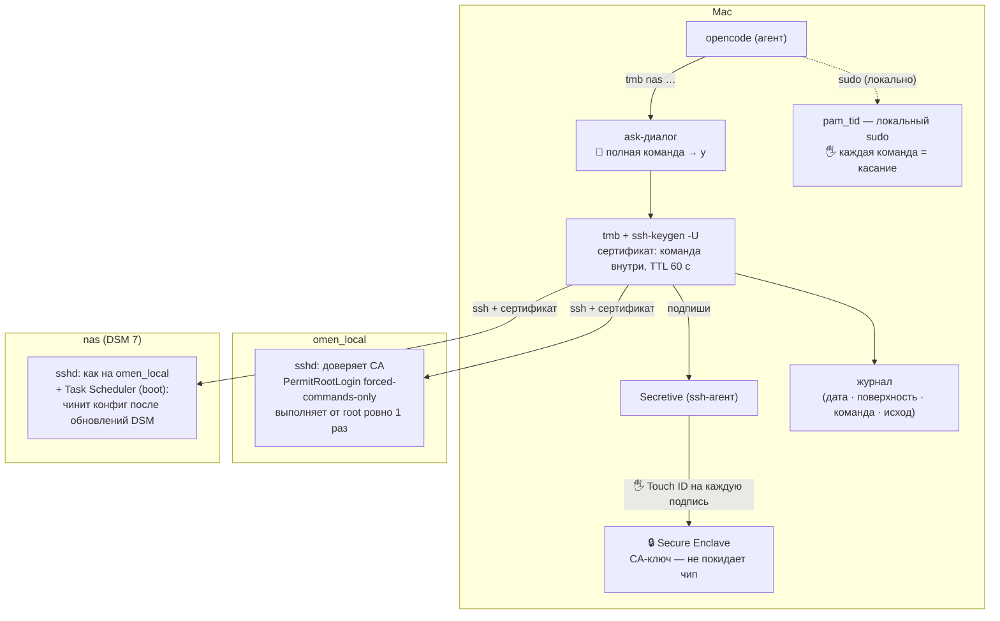
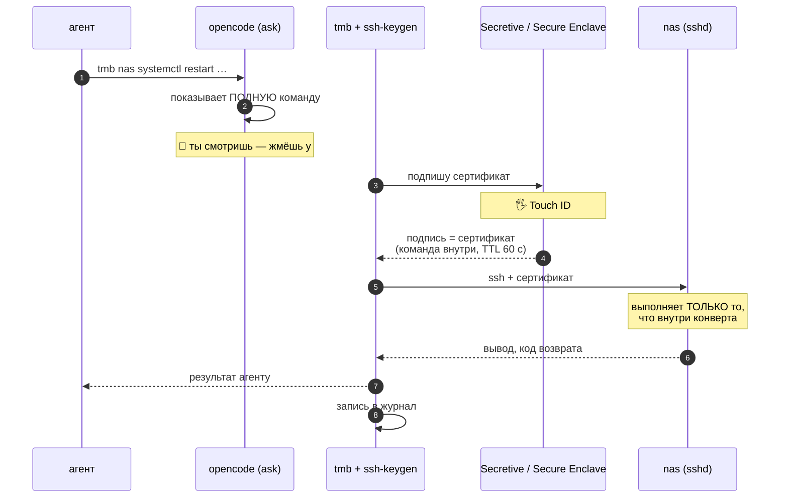
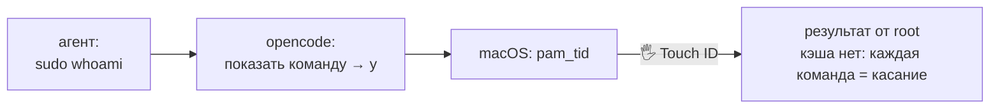

# TMB — Tool Mediation Broker

(неофициально: *trust me brother*)

Привиджированные команды для opencode-агентов — только через твой палец.

## Проблема

Агенты opencode выполняют команды в неинтерактивном bash: sudo не может спросить пароль и падает с «a terminal is required to read the password», а пароль в чат агенту отдавать нельзя. Любое обслуживание (`apt update`, рестарт демона на NAS) вырывает тебя из контекста агента в отдельный терминал.

## Решение

Единая команда для агента:

```
tmb <host> <command...>
```

Три ступени, каждая обязательна:

1. **Одобрение** — полная команда показывается тебе в ask-диалоге opencode.
2. **Подтверждение** — команда запаковывается в короткоживущий SSH-сертификат с `force-command` (подписанная команда); подпись даёт CA-ключ из Secure Enclave → **Touch ID**.
3. **Выполнение** — поверхность выполняет команду от root ровно один раз; сертификат живёт ~60 секунд и умирает сам.

Подпись — не «пропуск», а конверт: команда вшита внутрь сертификата, изменить её нельзя, подпись годится только для этого конверта. Хост игнорирует всё, что присылает клиент, и выполняет только то, что в сертификате. Диаграммы — ниже.

## Диаграммы

### Всё вместе: кто где стоит



### Путь удалённой команды, по секундам



### Локальная команда на Mac



## Поверхности

| Поверхность | Механизм | Касание |
|---|---|---|
| Mac (локальный sudo) | `pam_tid` в `sudo_local`, `timestamp_timeout=0` | на каждую sudo-команду |
| omen_local | сертификат + `force-command`, principal root | на каждую подпись |
| nas (DSM 7) | то же + Task Scheduler переживает обновления DSM | на каждую подпись |

На хостах `sudo` не используется вовсе: `TrustedUserCAKeys` + `PermitRootLogin forced-commands-only`.

## Установка

> Статус: v1 в разработке — [спека issue #1](https://github.com/Vchekryzhov/tmb/issues/1). Этот раздел — целевое состояние.

### Mac (один раз)

1. `brew install secretive` (Homebrew); создать в Secretive ключ — он станет CA.
2. Включить Touch ID для sudo (переживает обновления macOS):

   ```
   sudo tee /etc/pam.d/sudo_local <<'EOF'
   auth       sufficient     pam_tid.so
   EOF
   ```

3. Отключить кэш sudo: drop-in в `/etc/sudoers.d/` с `Defaults timestamp_timeout=0` (visudo-проверка обязательна).
4. opencode permissions: `tmb *` → ask, `sudo *` → ask, сырые `ssh *sudo*` → deny.

### omen_local (один раз, по SSH с паролем)

Установить доверие CA (`TrustedUserCAKeys`, `PermitRootLogin forced-commands-only`, principal root). Во время правки `sshd_config` держать открытой запасную SSH-сессию.

### nas (один раз + самовосстановление)

Как omen_local, плюс: фрагмент конфига и CA-ключ лежат персистентно в домашнем каталоге, а **Task Scheduler (boot, root)** восстанавливает их в `/etc/ssh/` — DSM затирает системные конфиги при обновлениях.

## Использование

```
$ tmb nas systemctl restart pkg-ContainerManager-dockerd
→ ask-диалог opencode показывает команду
→ Touch ID
→ вывод команды и код возврата уходят агенту
```

Отмена касания → внятная ошибка, ненулевой код возврата, агент просит человека.

Каждая подпись пишется в **журнал** (append-only): дата, поверхность, команда, исход.

## Безопасность

- Человек — политика: что подпрошешь, то и выполнится. Журнал — летопись, не шлюз.
- CA-ключ физически не покидает Secure Enclave.
- Сертификат: TTL ~60 с, расширения очищены (no-pty, no-forwarding, no-X11, no-agent) — только exec этой команды.
- Единственная оговорка: в пределах TTL тот же сертификат можно переиграть **той же** командой; произвольную — нельзя.
- Fallback, если агент Secretive не дружит с `ssh-keygen -U`: CA-ключ на диске + biometric-обёртка вокруг подписи.

## Тесты

Один шов: CLI `tmb` end-to-end против контейнерного sshd (Docker), подпись подменяется файловым тест-ключом. Свойства сертификата (`force-command` дословно, principal, TTL, без расширений) проверяются парсингом `ssh-keygen -Lf`. `make test`.

## Документы

- Словарь домена: [CONTEXT.md](CONTEXT.md)
- Решение об архитектуре: [docs/adr/0001](docs/adr/0001-oneshot-ssh-certificates-for-agent-sudo.md)
- Спека v1: [issue #1](https://github.com/Vchekryzhov/tmb/issues/1)
